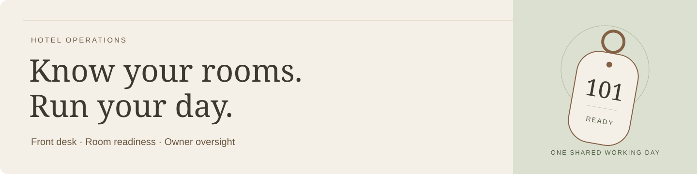
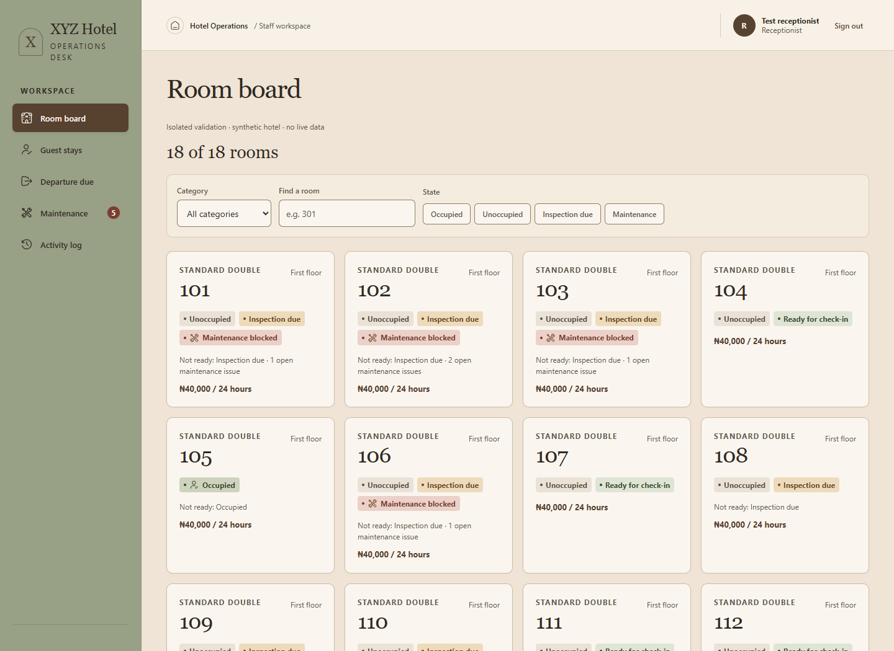

# Hotel Operations

**Know which rooms are ready, what needs attention, and what happened during the shift.**

Hotel Operations brings the front desk, room inspections, maintenance and daily payment records into one shared workspace. Built for independent hotels, it gives receptionists, supervisors and owners a clear view of the same working day.



*The actual room-board interface, shown with synthetic sample rooms. No real hotel or guest data.*

## A clearer working day

- **Find a room you can offer.** See occupancy, inspection needs and maintenance blocks together. An empty room is only part of the picture.
- **Keep the front desk moving.** Record walk-in arrivals, extend stays, move rooms and confirm departures, with payment records attached to the work.
- **Follow through on room condition.** Supervisors record personal inspections and track maintenance issues through resolution.
- **See what happened.** Owners and managers can review occupancy, room readiness, daily recorded payments and staff activity without piecing together separate updates.

## A workspace for each role

| Who | Their daily work |
| --- | --- |
| Receptionist | Find eligible rooms, manage stays, record payments and confirm departures. |
| Supervisor | Inspect rooms, record findings and report or resolve maintenance issues. |
| Owner / Manager | Review operations, follow up on attention items and manage staff access. |

The app is designed for staff, with layouts that adapt to desktop and smaller screens. It focuses on one property's walk-in operations; online reservations, guest accounts and payment processing are outside its current scope. Payments entered here are records of money received.

## Installation

**A technical administrator sets up the system; hotel staff then sign in through their browser.** You will need Git, Node.js **24.15 or newer**, **pnpm 12.4.2**, and a Supabase project for authentication and the database.

### 1. Get the app

```sh
git clone https://github.com/0xDaruby/Hotel-Operations-Software.git
cd Hotel-Operations-Software
pnpm install --frozen-lockfile
```

### 2. Prepare your hotel

Follow the [current setup guide](setup.md#current-setup--2026-10-16) to prepare the database, create the first Owner account, and add your property, room categories, rates and rooms. There is no default login or automatic hotel seed.

For a **new, empty Supabase project**, use the guide's [clean database instructions](setup.md#new-disposable-database). For an existing installation, follow the [upgrade instructions](setup.md#existing-live-database-upgrade-boundary) instead; the clean bootstrap must not be replayed on an existing hotel database.

### 3. Connect your installation

Copy [`.env.example`](.env.example) to a new `.env` file in the repository root. Fill in your Supabase URL and publishable key, the server-only service-role key, and `WEB_ORIGIN` (`http://localhost:3000` for local use). Keep `.env` private.

Configure the authentication redirect URLs and setup emails described in the [staff setup guide](setup.md#staff-setup-and-delivery), so newly created staff can finish setting their passwords.

### 4. Start locally

```sh
pnpm dev
```

Open [localhost:3000](http://localhost:3000) and sign in with your configured staff account. Starting the app does not create a hotel or staff accounts for you.

Before using it for a live shift, complete the [hotel launch checklist](docs/pilot-readiness.md), including backups, staff access and checks on the devices your team will use.

## More detail when you need it

- [Setup and deployment configuration](setup.md#current-setup--2026-10-16)
- [Hotel launch and recovery checklist](docs/pilot-readiness.md)
- [Product scope and operating rules](prd.md)
- [UI review and validation results](docs/verification/2026-10-19-ui-decisions.md)

---

Built by [0xDaruby](https://github.com/0xDaruby).
